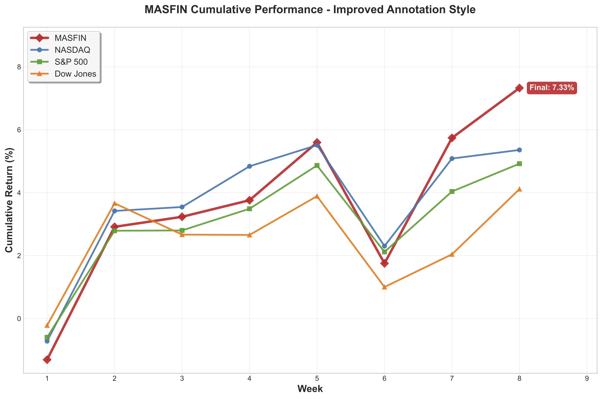
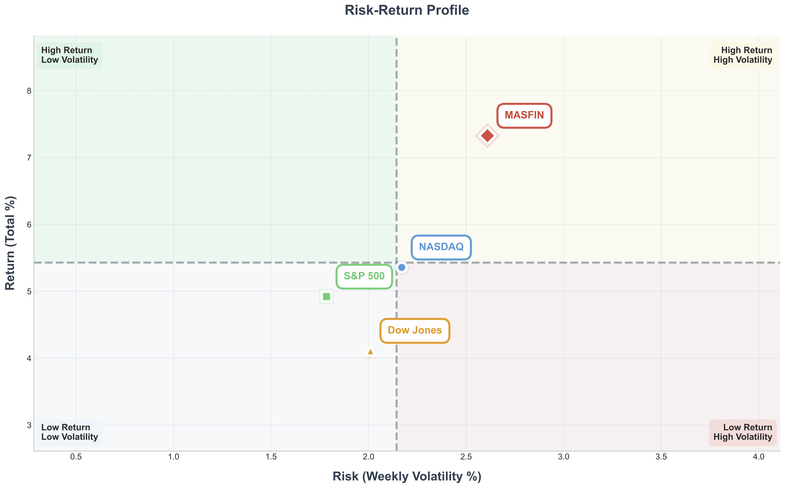

<dl class="fp-spec pj-spec">
  <dt>student</dt><dd>Sebastian Montalvo '28 · Muhlenberg undergraduate student researcher</dd>
  <dt>term</dt><dd>Summer 2025</dd>
  <dt>status</dt><dd>done</dd>
  <dt>framework</dt><dd>CrewAI · five sequential crews · human-in-the-loop validation</dd>
  <dt>data</dt><dd>Finnhub · Yahoo Finance</dd>
  <dt>evaluation</dt><dd>eight-week live · 7.33% cumulative return</dd>
  <dt>paper &amp; code</dt><dd><a href="https://github.com/mmontalvo9/MASFIN">github.com/mmontalvo9/MASFIN</a></dd>
</dl>



## Introduction

Financial forecasting represents one of the most complex challenges in data-driven decision making due to market volatility, non-stationarity, and the integration of quantitative and qualitative signals. Recent advances in **large language models (LLMs)** have renewed interest in this space, particularly through **multi-agent frameworks** that allow modular reasoning, interpretability, and reproducibility.

In this project, we introduce **MASFIN (Multi-Agent System for Decomposed Financial Reasoning and Forecasting)**, a generative, bias-aware framework designed to integrate structured financial data with unstructured news while embedding safeguards against survivorship, hindsight, and overfitting biases.

## Methods and Approach

MASFIN was implemented using **CrewAI**, organizing agents into five sequential "crews":

* **Postmortem Crew** – Analyzes delisted or failed firms to counter survivorship bias.
* **Screening Crew** – Filters candidate equities using sentiment and real-time data.
* **Analysis Crew** – Evaluates financial ratios and technical indicators across tickers.
* **Timing Crew** – Determines appropriate entry points using historical-only signals.
* **Portfolio Crew** – Constructs a 15–30 stock portfolio with risk-adjusted allocations.

Each stage incorporates human-in-the-loop validation to ensure transparency and reduce hallucinations. Data were collected from **Finnhub** and **Yahoo Finance**, combining quantitative metrics with qualitative sentiment analysis.

## Results

Over an **eight-week live evaluation**, MASFIN achieved a **7.33% cumulative return**, ahead of the **S&P 500 (4.92%)**, **NASDAQ-100 (5.36%)**, and **Dow Jones (4.11%)**. It gained in six of the eight weeks, a win rate comparable to the NASDAQ-100 and S&P 500, and beat all three indexes in four of them. The system exhibited higher volatility (2.61% weekly) but demonstrated a strong correlation with benchmark indices, suggesting enhanced performance within existing market trends.

  <figure class="research-figure">
    
    <figcaption>Figure 1: Cumulative Return</figcaption>
  </figure>
  <figure class="research-figure">
    
    <figcaption>Figure 2: Risk–Return Profile</figcaption>
  </figure>

These findings highlight the potential of **modular, bias-mitigated generative systems** for financial reasoning—offering improved reproducibility and interpretability compared to monolithic AI approaches.

## Conclusion

MASFIN demonstrates how **generative AI** can be harnessed for transparent and reproducible financial analysis. By integrating bias-aware design and modular agent collaboration, this framework provides a foundation for future research in high-stakes, data-intensive domains.
